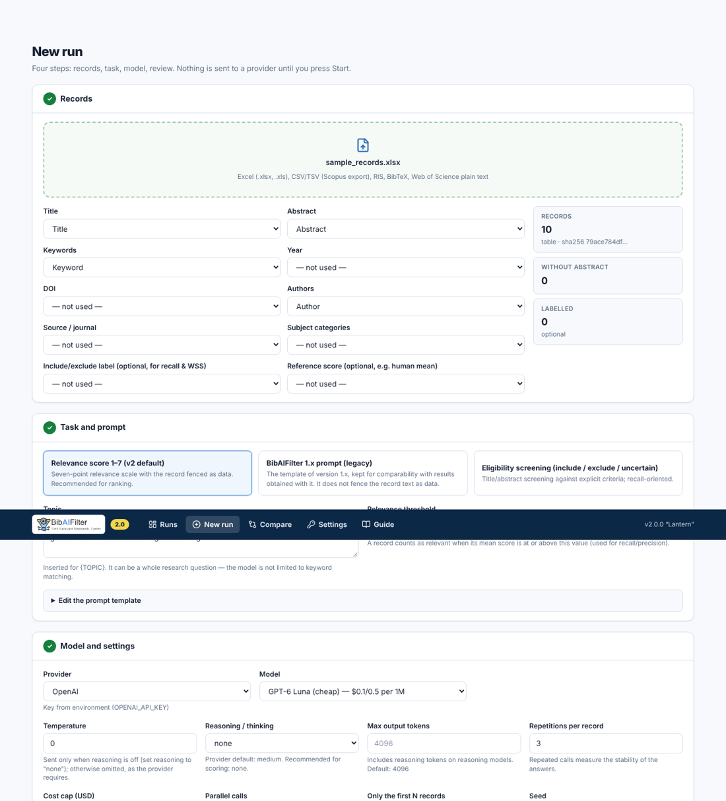

<div align="center">
  

  **LLM-assisted relevance scoring and eligibility screening of bibliographic records — with a full audit trail**

  [](LICENSE)
  [](https://www.python.org/downloads/)
  [](CHANGELOG.md)
  [](https://doi.org/10.5281/zenodo.15235413)
</div>

BibAIFilter sends each record of your literature export (title, abstract, keywords) to a large language
model and asks either **how relevant it is to your topic (1–7)** or **whether it meets your eligibility
criteria (include / exclude / uncertain)**. It runs on your own computer, opens in your browser, works
with OpenAI, Anthropic, Google Gemini, DeepSeek, OpenRouter and local open-weight models (Ollama), and
records every call so that a run can be checked, reported and repeated.

BibAIFilter supports human screening; it does not replace it.

<p align="center"></p>

## What's new in 2.0

Version 2.0 is a rewrite. The PyQt5 desktop application (1.x) is kept on the [`v1`](../../tree/v1) branch.

| | 1.x | 2.0 |
|---|---|---|
| Interface | PyQt5 desktop window | Browser interface served locally; Windows, macOS, Linux |
| Install | clone + `requirements.txt` | `pip install` / `pipx install`, or Docker |
| Tasks | relevance score 1–7 | relevance score 1–7 **and** eligibility screening with criteria |
| Failed or unparsable answer | silently written as score 4 | **no score**; status recorded (`empty`, `truncated`, `error`, …) |
| Model substitution | possible on errors, not recorded | **never**; the model named in each response is stored and mismatches are flagged |
| Parameters | configured temperature recorded, whether sent or not | **parameters actually sent** recorded per call |
| Retries | unlimited | at most 5 attempts, only for rate limits, server errors and timeouts; every attempt logged |
| Logs | none | per-call JSONL log, run manifest with versions and hashes |
| Output | Excel | Excel (records, calls, run, prompt), CSV, JSONL, manifest — saved to a folder you choose |
| Evaluation | — | stability across repetitions, agreement with a reference score, recall / precision / WSS@95 against labels, BM25 baseline, run comparison |
| Inputs | Excel | Excel, CSV (Scopus), RIS, BibTeX, Web of Science plain text |
| Cost | not shown | estimate before the run, cost per call, spending cap |
| Local models | — | Ollama and any OpenAI-compatible endpoint |

## Install

You need **Python 3.10 or newer**. Node.js is not needed.

```bash
pip install "git+https://github.com/bcankara/BibAIFilter.git"
bibaifilter
```

The browser opens at `http://127.0.0.1:8765/`. Stop the server with `Ctrl+C`.

- **macOS / Linux:** use `python3 -m pip …` if `pip` is not found.
- **Windows:** if `bibaifilter` is not recognised after installing, run `python -m bibaifilter`, or install
  with [pipx](https://pipx.pypa.io) (`pipx install "git+https://github.com/bcankara/BibAIFilter.git"`),
  which puts the command on your PATH.
- **Docker:** `docker compose up` (see [docker-compose.yml](docker-compose.yml)); then open `http://127.0.0.1:8765/`.
- Optional: `pip install keyring` to store API keys in the operating-system keychain.

## First steps

1. **Settings → API keys.** Paste a key for the provider you want to use, or set the usual environment
   variable (`OPENAI_API_KEY`, `ANTHROPIC_API_KEY`, `GEMINI_API_KEY`, `DEEPSEEK_API_KEY`,
   `OPENROUTER_API_KEY`). For a free, private alternative install [Ollama](https://ollama.com) and pull an
   open-weight model, e.g. `ollama pull qwen3:8b`.
2. **Settings → Workspace folder** (optional). Everything is saved there; the default is `~/BibAIFilter`.
3. **New run.** Upload your file, check the column mapping, describe the topic — a whole research
   question is fine — or the eligibility criteria, choose a model, name the run and pick the folder for
   the results. Start with a few records (“only the first N records”) and read the call log.

Try it with [`examples/sample_records.csv`](examples/sample_records.csv) (six invented records with
include/exclude labels).

## What you get

Each run has a folder `runs/<run id>/` in the workspace and, when it ends, a copy of its results in the
folder you chose (default `exports/<run name>_<run id>/`):

| File | Content |
|---|---|
| `<name>.xlsx` | **Records** (mean score or decisions, SD, valid/failed calls, BM25), **Calls** (one row per call), **Run** (settings, parameters actually sent, served models, counts, versions, hashes), **Prompt** |
| `<name>_calls.jsonl` | Full call log: requested and served model, parameters sent, every HTTP attempt, finish reason, raw answer, parse status, tokens incl. reasoning tokens, latency, cost |
| `<name>_calls.csv` | The call table as CSV |
| `<name>_manifest.json` | Tool, Python and package versions, configuration, prompt text and SHA-256, input file SHA-256, start/end time |

API keys never appear in any of these files.

### Answer statuses

Only `ok` and `extracted` carry a value. Every other status leaves the score empty and is counted.

| Status | Meaning |
|---|---|
| `ok` | The answer was exactly the expected value (structured JSON or a bare value). |
| `extracted` | The value was the only candidate in a longer answer (valid, flagged). |
| `truncated` | Cut off by the output-token limit, often because reasoning used the budget. |
| `empty`, `unparsable`, `ambiguous`, `out_of_range` | No usable value; the first number in a text is never taken, and out-of-range values are not clamped. |
| `refused` | Blocked by the provider. |
| `error` | Network, HTTP or provider error after the allowed retries; can be retried with **Resume**. |
| `skipped` | The record has neither title nor abstract. |

### Analyses

- **Stability:** between-repetition SD and the number of records whose answer changed.
- **Agreement with a reference score** (for example a mean expert rating): Spearman's ρ with an exact
  permutation p (n ≤ 10) and bootstrap CI, Kendall's τ-b, MAE, bias, Lin's CCC, ICC(A,1).
- **Screening performance against include/exclude labels:** recall, precision, specificity, F1, ROC AUC,
  WSS@95 and recall at 10/25/50 % screened, with a recall curve.
- **BM25 baseline** on the same records and query, next to every model result.
- **Run comparison:** rank correlations between runs and detection of identical score vectors.

## Models

The catalogue in the interface (`bibaifilter models`) lists current models with their parameter rules and
list prices, checked against the providers' documentation on 2026-11-10. Any other model identifier can
be typed in. Rules that matter for scoring:

- Output-token limits **include reasoning tokens** on reasoning models (OpenAI, Anthropic, Gemini,
  DeepSeek). BibAIFilter recommends the lowest reasoning level for scoring and uses generous limits; a
  truncated answer is reported as `truncated`, never scored.
- Temperature is sent only where the model accepts it. Recent Claude models reject it, Gemini 3.6+ and 4
  ignore it, OpenAI GPT-5.x/6 accept it only with reasoning off. What was sent is logged.
- Structured output (a JSON schema allowing only 1–7, or include/exclude/uncertain) is used where the
  provider supports it.

Open-weight models through Ollama keep all data on your computer and can be pinned to an exact version
(`ollama list` shows the digest), so a run can be repeated later. Hosted models change and are retired.

## Command line

```bash
bibaifilter                          # start the interface (same as `bibaifilter serve`)
bibaifilter serve --port 8800 --no-browser
bibaifilter run examples/run_spec_example.json      # scripted run, same logs and outputs
bibaifilter analyze <run id>
bibaifilter baseline examples/sample_records.csv --query "generative AI school education" --label-col included
bibaifilter models --provider anthropic
bibaifilter check openai gpt-6-luna  # one test call; reports the served model, never switches it
bibaifilter --data-dir D:\research\bibai   # use another workspace for this session
```

See [`examples/run_spec_example.json`](examples/run_spec_example.json) and
[`examples/run_spec_ollama.json`](examples/run_spec_ollama.json) for the spec format.

## Privacy and security

- Every call sends the record's title, abstract and keywords to the chosen provider. Check the provider's
  data-use terms (free tiers may use inputs for training) and the licence of your database, especially for
  unpublished records. With Ollama nothing leaves your computer.
- The server listens on `127.0.0.1` only, refuses requests addressed to other host names and refuses
  state-changing requests from other web sites.
- Keys are read from environment variables, the system keychain (with `keyring`) or a file in your
  user configuration folder (not in the workspace) readable only by your user account.

## Version 1.x and the pilot study

Version 1.x (PyQt5) is on the [`v1`](../../tree/v1) branch; the commits `795a4a5` (v1.0.0, 22 April 2025),
`f0e86a3` (v1.1.0) and `ecbc2a5` (April 2026 release) are unchanged. The pilot study published with
BibAIFilter was carried out with version 1.x; its data and analysis scripts are archived on
[Zenodo](https://doi.org/10.5281/zenodo.15235413).

## Development

```
src/bibaifilter/core/      engine, provider adapters, parsing, records, metrics, BM25, exports
src/bibaifilter/server/    FastAPI application (JSON API under /api, static interface)
src/bibaifilter/_web/      built interface (generated by scripts/build_web.sh)
web/                       Next.js source of the interface
tests/                     pytest suite (providers are mocked; no network)
```

```bash
python -m venv .venv && . .venv/bin/activate
pip install -e ".[dev]"
pytest
cd web && npm ci && npm run dev     # interface on :3000, talking to `bibaifilter serve` on :8765
bash scripts/build_web.sh           # rebuild src/bibaifilter/_web after changing web/
```

Contributions are welcome through issues and pull requests.

## Citation

If you use BibAIFilter, please cite the software (see [CITATION.cff](CITATION.cff)) and report the run
manifest (model identifier, served model, parameters sent, prompt hash, dates) in your methods.

## License

GNU General Public License v3.0 — see [LICENSE](LICENSE).
